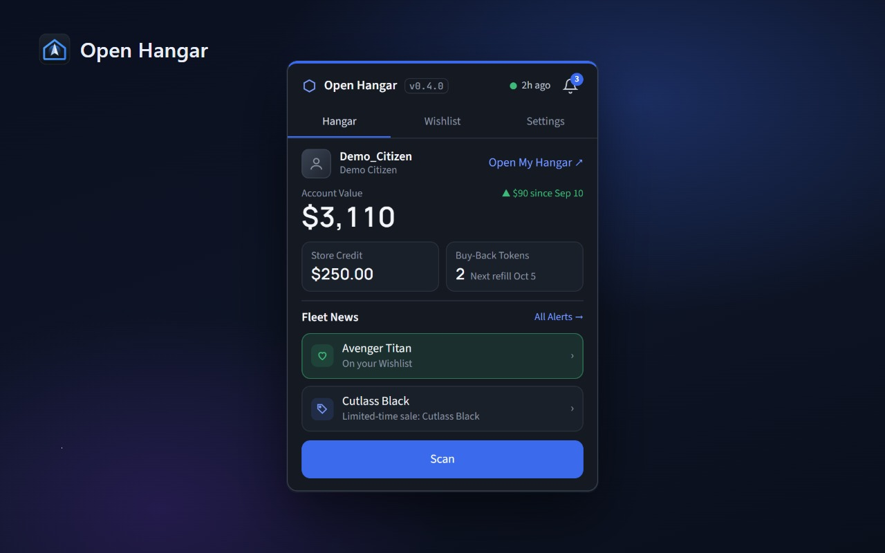

# Open Hangar

**The free Star Citizen fleet manager.**

[](https://github.com/Draco-Foundry/open-hangar/releases/latest)
[](https://github.com/Draco-Foundry/open-hangar/commits/main)
[](LICENSE)

Open Hangar comes in two parts that work together:

- **The Extension** for Chrome, Edge and Firefox reads your own Star Citizen account on RSI's
  website, right in your browser: every pledge, buy-back, balance and referral, made useful.
- **The Website**, [openhangar.space](https://openhangar.space/), has Star Citizen news and
  store tools today. At the **November 10, 2026** launch it also becomes your fleet manager:
  My Hangar on any device, a store that knows what you own, and a page for every ship.

Free for every pilot: no subscriptions, no premium tier, no paid features, and your data is
never sold.

**[Get Open Hangar](#get-open-hangar)** · [Road to Launch](#road-to-launch-november-10-2026) ·
[Full Roadmap](ROADMAP.md) · [Recently Shipped](#recently-shipped) ·
[Discord](https://discord.gg/FF8Wm5HdnV)

> Unofficial fan project, not affiliated with Cloud Imperium Games or RSI. Open Hangar only
> ever reads **your own** account.



## Get Open Hangar

The extension runs in Chrome, Edge and Firefox on a computer. Pick your browser on
[openhangar.space/extension](https://openhangar.space/extension), which shows each store's
current version, or go straight to a store:

- [Chrome Web Store](https://chromewebstore.google.com/detail/open-hangar/aeabioadfphghjennmdbnpelojlhndjl)
  (also for Brave, Opera and Vivaldi)
- [Microsoft Edge Add-ons](https://microsoftedge.microsoft.com/addons/detail/fmcnemfepnifokjelgjacgdhoodaiicl)
- [Firefox Add-ons](https://addons.mozilla.org/en-US/firefox/addon/open-hangar/)

Then:

1. Sign in to [RSI's Website](https://robertsspaceindustries.com/) in the same browser.
2. Click the Open Hangar icon in your toolbar (or press Alt+Shift+O) to open the popup.
3. Hit **Scan**, then **Open My Hangar** to see your whole hangar.

Re-scan any time to refresh. On the Settings tab, **Clear Data** wipes the local copy,
and **Log Out of RSI** ends your RSI session.

The website works in any browser, phone included, and from the Nov 10 launch that's where
My Hangar lives.

An invite-only tester round runs Oct 20 to 27, with invites on our
[Discord](https://discord.gg/FF8Wm5HdnV). Spots are limited.

## Where We're Headed

- **The Website Becomes Your Fleet Manager.** My Hangar on any device, store tools that know
  what you own, a page for every ship, and later your org and the wider community.
- **The Extension Stays Your Scanner.** It keeps reading your own RSI account in your browser
  and keeps getting better at it. From Nov 10, new features land on the website.
- **Your Data, Your Call.** From Nov 10 you can choose to sync: connect a free
  openhangar.space account and the extension syncs after every scan. Or skip it, and
  everything stays in your browser. Disconnect any time.

## Road to Launch: November 10, 2026

The website opens to everyone, and sign-ups open to everyone. The extension no longer
launches with it: 0.3.0 shipped on Oct 13, and 0.4.0 and 0.4.1 went to the stores on
Oct 14.

Website features come in **waves**, batches that are built and tested ahead of launch. A
wave's date is when it's built, not when you get it: Waves 1 to 3 are planned for launch day.
Anything that isn't ready and tested in time stays switched off until it is.

**Shipped** means you can use it now. **Built** means it's done and arrives Nov 10. All dates
are 2026, in UTC. Each bar fills as its tasks are done:

[](https://github.com/Draco-Foundry/open-hangar/milestone/6)
[](https://github.com/Draco-Foundry/open-hangar/milestone/7)
[](https://github.com/Draco-Foundry/open-hangar/milestone/8)
[](https://github.com/Draco-Foundry/open-hangar/milestone/9)
[](https://github.com/Draco-Foundry/open-hangar/milestone/4)

- [x] **Sep 28 to 30:** Shipped. Open Hangar is live on the Chrome, Edge and Firefox stores.
- [x] **Oct 2 to 7:** Shipped. openhangar.space becomes a Star Citizen news hub and opens the
      Open Hangar Store.
- [x] **Oct 13 to 14:** Shipped. Extension 0.3.0 and 0.3.1 make the extension a lighter
      connector, and 0.4.0 and 0.4.1 bring the new toolbar popup.
- [ ] **Oct 16:** [Wave 1: Core Hangar Manager](https://github.com/Draco-Foundry/open-hangar/milestone/6)
      built. My Hangar on the website, a page for every ship, and store badges for what you
      own.
- [ ] **Oct 16 to 19:** bug-fix days, with no new features.
- [ ] **Oct 20 to 27:** a tester round with 5 to 10 Discord testers on the public extension
      and the website.
- [ ] **Oct 25:** [Wave 2: Your Hangar Meets the Store](https://github.com/Draco-Foundry/open-hangar/milestone/7)
      built and in testing.
- [ ] **Oct 27:** code freeze for the extension, then a go or no-go call.
- [x] **Oct 28:** 0.3.0 submitted to Chrome, Edge and Firefox. It shipped early, on Oct 13.
- [ ] **Nov 3:** [Wave 3: Finishing Touches](https://github.com/Draco-Foundry/open-hangar/milestone/9) built.
- [ ] **Nov 10: [Launch](https://github.com/Draco-Foundry/open-hangar/milestone/4).** The website
      opens and sign-ups open to everyone.
- [ ] **Then:** four weeks of bug fixes and keeping ship and store data accurate.

The Oct 27 cut-off is for the extension, which needs store review. Website features can keep
landing until launch, and each one is tested before it's switched on. Every feature has its
own issue in the pinned [Road to Launch Tracker](https://github.com/Draco-Foundry/open-hangar/issues/468), and every step
is in
[All Milestones](https://github.com/Draco-Foundry/open-hangar/milestones?direction=asc&sort=due_date&state=open).

## After Launch

- **First Four Weeks:** bug fixes and keeping ship and store data accurate. No new features.
- **[December 2026](https://github.com/Draco-Foundry/open-hangar/milestone/10) (Planned):** community features on the
  website. Org Fleet (ships only, never prices or what anyone paid), Looking for Crew, Events
  (public, org or private) and phone alerts.
- **[Early 2027](https://github.com/Draco-Foundry/open-hangar/milestone/11):** on the website, value and savings, a trade post
  builder, a sale calendar, your hangar timeline, a shareable fleet card and a store credit
  check.
- **[Later in 2027](https://github.com/Draco-Foundry/open-hangar/milestone/12):** org matchmaking, Year in Review, starting
  a scan from the website, and more languages, one at a time.
- **Not Planned:** rankings or comparing players' hangars, CCU chain planning, Safari, and
  reading anyone else's account. [Here's Why](ROADMAP.md#not-planned-and-why)

Anything after launch is a plan, not a promise. The details are in the
[Full Roadmap](ROADMAP.md).

## Recently Shipped

- [x] **Oct 23, 2026 · 0.5.3:** Scan tells you in plain words when RSI isn't answering and
      keeps your last scan, your Wishlist and alerts still match ships RSI renames, the popup
      shows UEC and REC, and Connect uses Open Hangar's own sign-in window.
- [x] **Oct 14, 2026 · 0.4.0 and 0.4.1:** a new toolbar popup with three tabs, Hangar,
      Wishlist and Settings, plus an alerts bell. Also: scans that run out of sight, Auto Scan
      Daily (optional), your Wishlist in the popup, your own currency and light mode.
      ([0.4.0](https://github.com/Draco-Foundry/open-hangar/releases/tag/v0.4.0),
      [0.4.1](https://github.com/Draco-Foundry/open-hangar/releases/tag/v0.4.1))
- [x] **Oct 13 to 14, 2026 · 0.3.0 and 0.3.1:** the extension is now a lighter connector,
      and your full hangar opens on openhangar.space.
      ([0.3.0](https://github.com/Draco-Foundry/open-hangar/releases/tag/v0.3.0))
- [x] **Oct 6 to 7, 2026 · Website:** the store adds Compare (up to three items side by side),
      prices in your own currency and a What's New view of the latest drops. Pilots with a
      synced hangar (beta testers until launch) see an In Your Hangar mark on what they own,
      and can hide owned items.
- [x] **Oct 6 to 7, 2026 · Website:** a fresh front page with today's top stories, Ships in
      the News, a Patch, Roadmap and Issues card, and each subscriber tier's Vehicle of the
      Month.
- [x] **Oct 5, 2026 · 0.2.18 and 0.2.19:** Reclaim on an upgrade buy-back opens the right
      item, and the next buy-back token date keeps working past RSI's posted 2026 dates.
- [x] **Oct 4, 2026 · Website:** one page to get Open Hangar, showing each store's current
      version. ([Get the Extension](https://openhangar.space/extension))
- [x] **Oct 4, 2026 · 0.2.17:** much faster rescans when nothing has changed, and full-size
      pictures.
- [x] **Oct 3, 2026 · Website:** the [Open Hangar Store](https://openhangar.space/store) lists
      every item RSI sells, with its sale history, how often RSI sells it and insurance.

**[Everything We've Shipped](ROADMAP.md#shipped)** ·
[Release Notes](https://github.com/Draco-Foundry/open-hangar/releases) ·
[Changelog](CHANGELOG.md)

## What You Get Today

**In the Extension (0.4.1):**

- **The Toolbar Popup:** three tabs, Hangar, Wishlist and Settings. The Wishlist tab
  counts your Remind Me items in the store and lists them first, and the toolbar badge
  counts the ones you haven't seen. The Hangar tab shows your RSI portrait and handle,
  Account Value and how it changed since an earlier scan, Store Credit, UEC and REC at a
  glance, Buy-Back Tokens with the next refill, up to three Fleet News notes, and Scan.
- **Scans Out of Sight:** no scan tab. The scan runs in a hidden page, and closing the
  popup doesn't stop it.
- **When RSI Has Trouble:** if RSI changes a page or stops answering, Scan stops, tells you
  why in plain words and keeps your last scan.
- **Your Whole Hangar:** Open My Hangar shows My Hangar on openhangar.space when you're
  connected, or hangar.openhangar.space when you're not.
- **Store Alerts (Optional):** a badge and a notification when a ship in your buy-backs is
  back in the store, or a ship you own gets a new paint, a warbond edition or a
  limited-time sale. Matched on your device.
- **Daily Scan Reminder (Optional):** while you're connected to openhangar.space, Open
  Hangar can remind you once a day, with a notification, when it's time to scan. It never
  scans on its own. Off until you turn it on.
- **Your Wishlist:** while you're connected, search to add a ship, paint or upgrade, or
  remove an item. Search runs on your device. Ships still match after RSI renames them.
- **Add to RSI Cart:** put a ship upgrade (CCU) in your RSI cart in one click. You always
  check out on RSI yourself.
- **Your Currency, Light Mode and a Shortcut:** amounts show in US dollars until you pick
  another currency in Settings. Look follows your browser, or pick Dark or Light.
  Alt+Shift+O opens the popup (⌥⇧O on a Mac).
- **Your Data, Your Way:** JSON Backup, Pledges CSV and Buy-Backs CSV on the Settings tab.

**On [openhangar.space](https://openhangar.space/):**

- **Star Citizen News:** game status, an events calendar, what's live now, ships in the news
  and short summaries of official RSI posts.
- **The [Open Hangar Store](https://openhangar.space/store):** every item RSI sells, with its
  sale history, how often RSI sells it, insurance, side-by-side compare and prices in your
  own currency.
- **Accounts:** up and running, with sign-ups invite-only until launch. You can download
  everything the website holds about you from your Account page.

## Privacy

- **Your Own Account Only.** Open Hangar uses the RSI session you're already signed in with
  and never sees your password.
- **Read-Only Scans.** Scans only read, and they pace their requests so RSI's site isn't
  flooded.
- **No Account Needed:** the extension and our hangar page, hangar.openhangar.space, work
  without an account. Without sync, the only other requests fetch public files from
  openhangar.space, like the status file, the ship list and exchange rates, the same for
  everyone and with nothing about you. The `cookies` permission is used only on RSI: for
  **Log Out of RSI**, to see whether you're signed in to RSI, and for **Add to RSI Cart**.
  Each RSI account's data is kept separately, so accounts never mix.
- **Optional Sync (Open to Everyone From Nov 10, 2026):** your data stays in your browser
  unless you connect a free openhangar.space account. Once connected, every scan sends the
  same data as the JSON export to your account there (Sync Now sends it right away).
  Disconnect stops it, and the website lets you download or delete everything. With or
  without sync, the extension talks only to RSI and openhangar.space. Apart from reading
  your own account, syncing and your Wishlist, those requests fetch public files that are
  the same for everyone.
- **Add to RSI Cart (0.3.0)** is the one thing that isn't read-only: when you click it, one
  upgrade goes into your RSI cart. It never checks out or pays.

[Extension Privacy Policy](https://openhangar.space/privacy.html) ·
[Privacy Policy Source](docs/PRIVACY.md) ·
[Website Privacy Policy](https://openhangar.space/privacy)

## For Developers

RSI has no public API for your hangar, so the extension handles the session and the page
parsing in your browser and turns your account into clean records you can browse and export.

<details>
<summary><strong>Build From Source</strong></summary>

```bash
git clone https://github.com/Draco-Foundry/open-hangar.git
cd open-hangar
npm install
npm run build
```

- **Chrome, Edge, Brave:** open `chrome://extensions`, turn on **Developer mode**, click
  **Load unpacked** and pick `dist/chrome`.
- **Firefox (140+):** open `about:debugging`, then **This Firefox**, then **Load Temporary
  Add-on**, and pick `dist/firefox/manifest.json`.

That's the store build. To work on the extension, run the developer's copy instead.

</details>

<details>
<summary><strong>Run a Developer's Copy</strong></summary>

A developer's copy runs in a browser profile of its own, so it never touches the Open
Hangar you installed from a store or the hangar it saved:

```bash
npm run dev:chrome
```

`npm run dev:edge` and `npm run dev:firefox` do the same in Edge and Firefox. Each builds
**Open Hangar (Dev)** (purple icons with a DEV tag) into `dist/dev/` or
`dist/dev-firefox/` and opens the browser with a profile kept in `.dev-profiles/` (not
committed), so you sign in to RSI there once. Close the browser or press Ctrl+C to stop.
It syncs to staging.openhangar.space, never your real account on app.openhangar.space
(add `--site=https://app.openhangar.space` to `dev:build` if you mean to). Staging lets in
Firefox copies, and Chrome or Edge copies whose ids it has been told about.
If the browser isn't where it usually is, set `CHROME_PATH`, `EDGE_PATH` or
`FIREFOX_PATH`. Build flags: `npm run dev:build -- --flag name=on`, then
`node scripts/dev-run.mjs chrome`.

Don't load `dist/firefox` into the Firefox profile your store copy is in: it carries the
store copy's add-on id, so Firefox puts it in the store copy's place, with its saved
hangar. The developer's copy has its own id.

</details>

<details>
<summary><strong>What It Reads</strong></summary>

- **Hangar:** every pledge (ships, CCUs `from → to`, paints, add-ons, coupons) with its
  contents, value, date, insurance, and whether it's giftable or meltable.
- **Buy-Backs:** melted pledges you can get back, each with a direct reclaim link.
- **Account:** handle, display name, Store Credit, UEC, REC, main org and rank.
- **Referrals:** recruits and prospects (current and legacy programs).

Everything lives in one versioned database in your browser, and exports as one JSON file or
a CSV of your pledges or buy-backs (a developer's build with the dashboard also writes a
Hangar Transfer Format (HTF) file).

</details>

<details>
<summary><strong>The Data</strong></summary>

Every pledge is normalized to one object:

```js
{ id, name, value, currency,
  contents: [{ kind, label, image }],   // items inside the pledge
  image, containsShip,
  isCCU, ccu: { from, to },
  isAddOn, isCoupon, isPaint,
  giftable,                              // hangar offers a "Gift" action
  insurance,                             // 'LTI' | '120M' | '6M' | … | null
  kind }                                 // ship | ccu | paint | addon | coupon | other
```

Sources live in a registry (`OH.SOURCES`) and persist as one versioned object:
`{ schemaVersion, sources: { hangar, buybacks, referral }, owner }`.

The **JSON export** wraps that with provenance and an identity block, ordered from who to
what they own:

```js
{ app, appVersion, exportedAt, schemaVersion,   // provenance
  account: {                                     // identity snapshot
    handle, displayName, avatar,
    ueeRecord, enlistedSince, country,
    organization: { name, sid, rank, logo },     // null if none / private
    subscriber, concierge,
    balances: { storeCredit, uec, rec },         // storeCredit.value is in cents
    capturedAt },
  sources: { hangar: {…}, buybacks: {…},
    referral: { items: { current, legacy, prospects,
                         recruitsList, prospectsList } } },  // referral code/url never exported
  history: [ { at, items: [[id, name, value]] } ],        // scan snapshots; merged on import
  pledgeArchive: { [pledgeId]: { id, name, value, currency, insurance, ccu,
                   kind, date, contents: [{ kind, label }], goneAt } } }
                   // pledges gone from the hangar (newest 2,000), for buy-back
                   // details; merged on import (newest goneAt wins)
```

</details>

<details>
<summary><strong>How It Works</strong></summary>

RSI signs you in with a session cookie. Because the extension has host permission for
`robertsspaceindustries.com`, its own requests carry your existing session: no password and
no RSI tab needed. Pages are fetched and parsed in your browser (referrals come from RSI's
GraphQL API). Scans are read-only and rate-limited.

RSI updates its site from time to time. All HTML parsing is isolated in
`src/scraper/parser.js`, and where it looks (selectors, patterns) is one data file,
`src/data/parser-rules.json`, so when the markup changes there's one place to fix.

```
manifest.json           permissions + config (Chrome-shaped; see scripts/pack.mjs)
src/
  background.js         the popup's scans, the badge, alerts, our pages' messages
  lib.js                source registry, scan loop, storage, export/import
  scraper/parser.js     RSI HTML -> normalized model   (the layer to maintain)
  data/parser-rules.json  where things are on RSI's pages (the parser rules)
  popup.html            the toolbar popup
  scan.html             the hidden scan page (scan-host.js opens it)
  basic.html            the small Open Hangar page
  dashboard.html / .js  the old dashboard (developer builds without the connector)
ui/                     Svelte pages, built with Vite
scripts/pack.mjs        builds per-browser bundles into dist/
```

The [Architecture Tour](ARCHITECTURE.md) walks through it all in about ten minutes.

</details>

<details>
<summary><strong>Export, Import and Commands</strong></summary>

The contract is the data shape above plus **JSON export and import**: JSON Backup on the
popup's Settings tab pulls the whole database out as one self-describing file, and the
dashboard's Developers page (a developer's build) restores it. Import restores holdings;
the `account` block is a read-only snapshot.

**Export HTF** (the dashboard's Developers page) writes the community Hangar Transfer
Format: one entry per ship with `ship_code`, manufacturer, `pledge_*`, `lti` and
`warbond`, ready for any fleet tool that reads HTF. Ship codes come from a bundled MIT-licensed table in `src/data/` (credited in the
[Third-Party Notices](THIRD_PARTY_NOTICES.md)). CCUs, paints and add-ons have no HTF
equivalent and are skipped.

Useful commands:

- `npm test`: the test suite
- `npm run build`: per-browser bundles in `dist/chrome` and `dist/firefox`
- `npm run pack`: store-ready zips in `dist/`
- `npm run lint:firefox`: Mozilla's `web-ext lint` against the Firefox build
- `npm run screenshots`: the dashboard's screenshots (real UI, demo data) into
  `docs/store-assets/` (the store uses the popup's, `screenshot-040-*`)
- `npm run demo`: the demo dashboard, popup and basic page at `localhost:8323`, for trying
  UI changes
- `npm run format`: Prettier

To add a data source, see the [Contributing Guide](CONTRIBUTING.md).

</details>

## Ideas, Bugs and Help

- **Got an Idea?** Post it in
  [Ideas Discussions](https://github.com/Draco-Foundry/open-hangar/discussions/categories/ideas)
  and upvote the ones you want most. That's how we pick what to build next.
- **Found a Bug?** [Open an Issue](https://github.com/Draco-Foundry/open-hangar/issues/new/choose).
  If a scan breaks, the extension's **Report a Scan Problem** button fills in the details for
  you. It opens a GitHub issue, so it needs a GitHub account.
- **No GitHub Account?** Tell us on [Discord](https://discord.gg/FF8Wm5HdnV) or at
  [support@openhangar.space](mailto:support@openhangar.space).
- **See What's Open:**
  [Open Bugs](https://github.com/Draco-Foundry/open-hangar/issues?q=is%3Aissue+is%3Aopen+label%3Abug)
  ·
  [All Milestones](https://github.com/Draco-Foundry/open-hangar/milestones?direction=asc&sort=due_date&state=open)

## Contributing

The most valuable help is keeping the RSI reader working when RSI updates its site. Start
with the [Contributing Guide](CONTRIBUTING.md); the [Architecture Tour](ARCHITECTURE.md)
shows how it all fits together in about ten minutes. This repo holds the extension's code,
and website features are tracked here as issues too. A change players will notice also
adds a small file to [changelog.d/](changelog.d/README.md) instead of editing the
changelog.

## Terms and Fair Use

Scans are read-only and rate-limited, and Open Hangar reads only the signed-in pilot's own
account. Respect [RSI's Terms of Service](https://robertsspaceindustries.com/tos) and don't
redistribute other people's data.

## License and Community

Code: source available under the [PolyForm Strict License 1.0.0](LICENSE). Read it, audit it
and use Open Hangar, but don't redistribute it or publish modified versions. Releases before
0.2.12 were MIT. Third-party code keeps its own license
([Third-Party Notices](THIRD_PARTY_NOTICES.md)). Open Hangar uses no Star Citizen Fankit
assets. Star Citizen® and related names are trademarks of Cloud Imperium Rights LLC; this is
an unofficial fan project, not affiliated with the Cloud Imperium group of companies.

- **Website:** [openhangar.space](https://openhangar.space/)
- **Discord:** [Draco Foundry](https://discord.gg/FF8Wm5HdnV)
- **Email:** [support@openhangar.space](mailto:support@openhangar.space)
- **Security Issues:** please report privately, see the [Security Policy](SECURITY.md).

See you in the 'verse. o7
